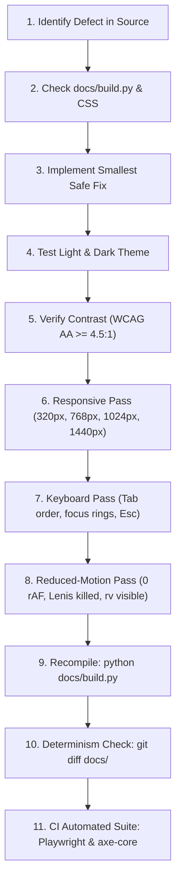

# UI/UX & Frontend Developer Architecture Guide
**GautamTheAnalyst.io — Design Systems, Color Palettes, Animations, 3D WebGL, & Bug Fixing Handbook**

---

## 1. System Architecture & Compilation Pipeline

### 1.1 Single Source of Truth
This website is a high-performance static site published via GitHub Pages from the `docs/` folder.
HTML pages are **not authored manually**. All 8 pages are compiled programmatically from Python templates:
- [docs/build.py](docs/build.py): Master compiler generating all pages, navigation, metadata, and structured data.
- [docs/flows.py](docs/flows.py): Generates inline decorative SVG diagrams (BPMN, ERD, sequence diagrams) with HTML safety escaping.
- [docs/assets/style.css](docs/assets/style.css): Unified stylesheet containing all tokens, layout rules, and media queries.
- [serve.py](serve.py): Local development HTTP server with no-cache headers.

> [!IMPORTANT]
> **Never edit `.html` files directly.** Direct modifications to `docs/*.html` will be overwritten when `python docs/build.py` runs. Always modify [docs/build.py](docs/build.py) or [docs/assets/style.css](docs/assets/style.css), then recompile.

```bash
# Recompile website after any Python, CSS, or JS changes:
python docs/build.py
# On Windows, you can also use: py -3 docs/build.py
# On macOS/Linux: python3 docs/build.py

# Run local development server:
python serve.py
```

### 1.2 Dynamic SHA-256 Content-Hash Cache-Busting
Cache busting is automated. The compiler computes the first 8 hex characters of the SHA-256 hash of each static asset file (`style.css`, `site.js`, `card-fx.js`, `bg-anim.js`, `ascii-wave.js`, `globe.js`, `lenis.min.js`) and injects it into all `<link>` and `<script>` URLs:
```html
<link rel="stylesheet" href="assets/style.css?v=023ef33a">
<script src="assets/vendor/lenis.min.js?v=35780133" defer></script>
<script src="assets/site.js?v=5e11ff89" defer></script>
```
Manual `?v=XX` version integers are never required; any asset change automatically busts client caches across all 8 compiled pages.

---

## 2. Design Tokens & Color Systems

The site uses a strict CSS variable token system mapped under `:root` (Light Theme) and `[data-theme="dark"]` (Dark Theme). Both themes declare `color-scheme: light` and `color-scheme: dark` respectively, supported by `<meta name="color-scheme" content="light dark">` in `<head>`.

### 2.1 Core Palette Tokens
| Token | Light Theme | Dark Theme | Purpose |
| :--- | :--- | :--- | :--- |
| `--ink` | `#0f172a` (Slate 900) | `#f8fafc` (Slate 50) | Primary body text and headers |
| `--muted` | `#475569` (Slate 600) | `#94a3b8` (Slate 400) | Secondary body text, timestamps, subtitles |
| `--accent` | `#2563eb` (Blue 600) | `#3b82f6` (Blue 500) | Text links, focus rings, and dark-surface accents |
| `--btn-bg` | `#2563eb` (Blue 600) | `#2563eb` (Blue 600) | Filled primary buttons and solid badges (≥ 5.17:1 contrast on white) |
| `--btn-fg` | `#ffffff` | `#ffffff` | Foreground text on primary buttons |
| `--accent-2` | `#0369a1` (Sky 700) | `#38bdf8` (Sky 400) | Secondary gradient stops, cyan accents |
| `--accent-3` | `#4f46e5` (Indigo 600) | `#6366f1` (Indigo 500) | Tertiary badge fills, gradient endpoints |
| `--bg` | `#f8fafc` | `#0b0f19` | Top-level document background |
| `--surface` | `#ffffff` | `#111827` | Primary card faces, modal panels, inputs |
| `--soft` | `#f1f5f9` | `#162036` | Secondary inset boxes, table headers |
| `--line` | `#e2e8f0` | `#1e293b` | Structural borders, dividers, card boundaries |
| `--field-border`| `#64748b` | `#94a3b8` | Form field boundaries (guarantees ≥ 3:1 contrast) |

### 2.2 Spatial, Radius, Shadow & Z-Index Tokens
```css
:root {
  /* Spacing Scale (Base 4) */
  --space-1: 4px;
  --space-2: 8px;
  --space-3: 12px;
  --space-4: 16px;
  --space-5: 24px;
  --space-6: 32px;
  --space-7: 48px;
  --space-8: 64px;

  /* Border Radii */
  --radius-sm: 4px;
  --radius-md: 8px;
  --radius-lg: 12px;

  /* Elevation Shadows */
  --shadow-1: 0 1px 3px rgba(15, 23, 42, 0.08);
  --shadow-2: 0 4px 12px rgba(15, 23, 42, 0.12);
  --shadow-3: 0 12px 32px rgba(15, 23, 42, 0.16);

  /* Z-Index Hierarchy */
  --z-header: 50;
  --z-drawer: 100;
  --z-modal: 200;
  --z-toast: 300;
}
```

### 2.3 Semantic Status Colors (WCAG 2.2 AA Verified)
All status badges on deliverables, projects, and test cases use dedicated tokens meeting WCAG AA contrast (≥ 4.5:1 text-to-badge, ≥ 3:1 badge-to-background). Every badge carries `border: 1px solid currentColor` to guarantee visible edge definition regardless of OS display calibration.
```css
/* Light Mode */
--status-approved: #047857;     /* Emerald 700 */
--status-approved-bg: #ecfdf5;  /* Emerald 50 */
--status-review: #b45309;       /* Amber 700 */
--status-review-bg: #fffbeb;    /* Amber 50 */
--status-sprint: #6d28d9;       /* Violet 700 */
--status-sprint-bg: #f5f3ff;    /* Violet 50 */
--status-draft: #475569;        /* Slate 600 */
--status-draft-bg: #e2e8f0;     /* Slate 200 - Visibly distinct from --bg (#f8fafc) */
--status-notrun: #334155;       /* Slate 700 */
--status-notrun-bg: #e2e8f0;    /* Slate 200 - Visibly distinct from --soft (#f1f5f9) */

/* Dark Mode */
[data-theme="dark"] {
  --status-approved: #34d399;   /* Emerald 400 */
  --status-approved-bg: rgba(52, 211, 153, 0.15);
  --status-review: #fbbf24;     /* Amber 400 */
  --status-review-bg: rgba(251, 191, 36, 0.15);
  --status-sprint: #c084fc;     /* Violet 400 */
  --status-sprint-bg: rgba(192, 132, 252, 0.15);
  --status-draft: #94a3b8;      /* Slate 400 */
  --status-draft-bg: rgba(148, 163, 184, 0.20); /* Visibly distinct fill */
  --status-notrun: #cbd5e1;     /* Slate 300 */
  --status-notrun-bg: rgba(203, 213, 225, 0.20); /* Visibly distinct fill */
}

.status-badge, .badge {
  border: 1px solid currentColor; /* Enforces 3:1 boundary contrast */
}
```

### 2.4 Color-Mix & Transparency Fallback Rules
> [!WARNING]
> Browsers without `color-mix()` support (e.g. legacy engines) will discard entire declarations if fallback values are omitted.

**Always specify a token fallback property (`var(--surface)`) immediately before `color-mix`:**
```css
/* CORRECT: Safe color-mix implementation */
.card-featured {
  background: var(--surface); /* Token fallback for legacy engines */
  background: color-mix(in srgb, var(--accent) 5%, var(--surface));
  border-left: 4px solid var(--accent);
}
```

### 2.5 Theme Flash Elimination (FOUC Prevention)
To eliminate white flashes during dark theme loads, an inline blocking script executes in `<head>` prior to stylesheet parsing:
```html
<script>
document.documentElement.classList.add("js");
try {
  var t = localStorage.getItem("gr-theme") || (matchMedia("(prefers-color-scheme: dark)").matches ? "dark" : "light");
  document.documentElement.dataset.theme = t;
} catch(e) {}
setTimeout(function(){ document.documentElement.classList.add("rv-fallback"); }, 1200);
</script>
```

---

## 3. Typography & Hierarchy System

The typography system uses three complementary typefaces with preloaded web fonts and a size-adjusted local fallback to eliminate Cumulative Layout Shift (CLS):
- **Body & Primary UI (`--sans`):** `'IBM Plex Sans', 'IBM Plex Sans Fallback', -apple-system, BlinkMacSystemFont, 'Segoe UI', Roboto, sans-serif`
- **Technical & Metric Data (`--mono`):** `'IBM Plex Mono', ui-monospace, Menlo, Monaco, Consolas, monospace`
- **Editorial Sub-headings (`--serif`):** `'Source Serif 4', Georgia, serif`

### 3.1 Font Loading Strategy & Fallback Face
Fonts are loaded with `display=swap`, accompanied by `<link rel="preload" as="style">` and `preconnect` headers:
```css
/* Zero-CLS Fallback Face */
@font-face {
  font-family: 'IBM Plex Sans Fallback';
  src: local('Arial'), local('Helvetica');
  size-adjust: 100.2%;
  ascent-override: 102%;
  descent-override: 28%;
  line-gap-override: 0%;
}
```
*Architecture Decision:* Google Fonts CDN with preconnect/preload delivers global edge caching and compression without inflating repository storage. The size-adjusted fallback face guarantees zero layout shifts prior to font swap.

### 3.2 Focus & Accessibility Rules
- **Focus Rings:** Global focus visibility is governed by `:focus-visible`:
  ```css
  :focus-visible {
    outline: 2px solid var(--accent);
    outline-offset: 3px; /* Guarantees 3:1 boundary contrast across both themes */
  }
  ```
- **Skip Link:** A high-contrast skip link (`<a class="skip" href="#main">Skip to content</a>`) is the first focusable element on every page.
- **Scrollable Data Tables:** Tables are wrapped in `<div class="table-scroll" tabindex="0" role="region" aria-label="...">` allowing complete keyboard navigation.
- **System Accessibility Modes:**
  - `@media (forced-colors: active)` preserves explicit borders on badges, buttons, and cards using `ButtonText`, `CanvasText`, and `Highlight`.
  - `@media (prefers-contrast: more)` increases contrast on `--line` (`#94a3b8` / `#475569`) and `--muted` (`#1e293b` / `#f1f5f9`).

---

## 4. Layout Architecture & Breakpoint Standards

### 4.1 Grid & Container Hierarchy
The layout is governed by a centered `.wrap` container:
- Maximum container width: `1180px`
- Gutter padding: `clamp(16px, 3vw, 28px)`
- Section vertical rhythm: `clamp(48px, 6vw, 96px)`

### 4.2 Standard Responsive Breakpoints
Breakpoints are defined in [docs/build.py](docs/build.py) and [docs/assets/style.css](docs/assets/style.css):
```python
BP_MOBILE_SM = 320   # Compact Mobile (iPhone SE)
BP_MOBILE_MD = 480   # Standard Mobile
BP_TABLET_SM = 768   # Portrait Tablet / Foldables
BP_TABLET_MD = 860   # Landscape Tablet
BP_DESKTOP_SM = 1000 # Small Desktop / iPad Pro
BP_DESKTOP_MD = 1180 # Standard Content Container Max-Width
BP_DESKTOP_LG = 1440 # Large Desktop Displays
```

- **`320px – 430px` (Compact Mobile):** Single-column stacks, mobile hamburger navigation, full-width buttons, horizontal overflow strictly prevented (`scrollWidth <= clientWidth`).
- **`768px – 860px` (Tablets / Foldables):** 2-column cards, condensed tables inside `.table-scroll`, flex layout switching.
- **`1000px – 1024px` (Small Desktop):** Standard multi-column grid transition.
- **`1280px – 1920px` (High-DPI Desktop):** Full multi-column layout with 3D canvas sidebars.

### 4.3 Featured Document Card & Specification Rack Pattern
When presenting grouped multi-item deliverables (such as the 35-page BA Document Pack):

```
+-----------------------------------------------------------------------------------+
| [ICO] Complete BA Document Pack — Payment Reconciliation Engine (Featured) [BADGE]|
| 35 pages • 170 KB • Comprehensive 17-deliverable Business Analysis Document Pack   |
+-----------------------------------------------------------------------------------+
| [01 BRD]       | [02 FRD]       | [03 Stories]   | [04 RTM]       | [05 MoM]      |
| Scope & RACI   | System Specs   | BDD Criteria   | UAT & Tests    | RAID Log      |
+-----------------------------------------------------------------------------------+
| [Download Full PDF (170 KB)]                     [Preview Document Excerpts]      |
+-----------------------------------------------------------------------------------+
```

**Implementation Rules:**
1. Never overlap cards with tight negative translations (`translateX(-90px)`), which clips text.
2. Use `display: grid; grid-template-columns: repeat(5, minmax(0, 1fr)); gap: 12px;` so each item has equal, unclipped width.
3. On mobile (`<= 860px`), collapse to `grid-template-columns: repeat(auto-fit, minmax(130px, 1fr))`, and at `<= 480px` collapse to 2 columns.
4. Keep action buttons in a full-width bottom flex row (`display: flex; gap: 12px;`).

---

## 5. Animations & Motion Systems

### 5.1 Scroll Reveals (`.rv`) & Reduced Motion Fallbacks
- **Graceful JS Fallback:** Elements with `.rv` are hidden **only** when JavaScript is confirmed active via `.js .rv { opacity: 0; transform: translateY(18px); }`. If JavaScript is disabled or fails to run, elements remain 100% visible.
- **Safety Net:** A `<noscript><style>.rv{opacity:1!important;transform:none!important}</style></noscript>` tag protects no-script environments.
- **Print & Reduced-Motion Overrides:**
  ```css
  @media print, (prefers-reduced-motion: reduce) {
    .rv {
      opacity: 1 !important;
      transform: none !important;
      translate: none !important;
      scale: 1 !important;
      transition: none !important;
    }
  }
  ```

### 5.2 Lenis Smooth Scrolling Integration
- **Conditional Initialization:** Lenis is initialized only when `prefers-reduced-motion: reduce` is false. If the user alters system motion preferences during runtime, Lenis is immediately destroyed.
- **Anchor Offsets:** In-page anchor links (`#id`) scroll via `lenis.scrollTo(target, { offset: -72, onComplete: () => target.focus() })`, preserving keyboard focus and find-in-page functionality.
- **Modal & Drawer Pausing:** When the mobile menu, preview drawer, or image lightbox is active, `lenis.stop()` pauses scrolling; `lenis.start()` resumes it on dismissal.

### 5.3 Canvas Animation Loops & Battery Protection
Canvas animations ([docs/assets/bg-anim.js](docs/assets/bg-anim.js), [docs/assets/ascii-wave.js](docs/assets/ascii-wave.js), [docs/assets/globe.js](docs/assets/globe.js)) implement a strict four-condition loop guard:
1. **Viewport Intersection:** Monitored via `IntersectionObserver`.
2. **Tab Visibility:** Monitored via `document.hidden` / `visibilitychange`.
3. **Reduced Motion:** Checked via `window.matchMedia('(prefers-reduced-motion: reduce)')` including live change listeners.
4. **Site Motion Toggle:** Responds to the global `#motionToggle` state (`site-motion-toggle`).

```javascript
// Unified Loop Guard Pattern
var rafId = null;

function shouldRun() {
  return isVisible && !isTabHidden && !prefersReducedMotion() && !siteMotionPaused;
}

function start() {
  if (!rafId && shouldRun()) {
    lastTime = performance.now();
    rafId = requestAnimationFrame(frame);
  }
}

function pause() {
  if (rafId) {
    cancelAnimationFrame(rafId);
    rafId = null;
  }
}
```

---

## 6. 3D Effects, Perspective & WebGL Globe

### 6.1 Interactive 3D Dotted Globe ([docs/assets/globe.js](docs/assets/globe.js) & [docs/assets/cobe.js](docs/assets/cobe.js))
The hero and contact sections feature an orthographic dotted globe with a marker on Bengaluru, India (`12.97° N, 77.59° E`). Decorative canvases carry `aria-hidden="true"`.

#### Coordinate & Rotation Convention
In `cobe.js`, the camera view direction is along $+Z = (0, 0, 1)$ and longitude rotates around the $Y$-axis. Centering Bengaluru requires:
$$\theta = 0.23\text{ rad},\quad \phi = -\text{lon} - \frac{\pi}{2} = -77.59^\circ \times \frac{\pi}{180^\circ} - 1.5708 = 3.358\text{ rad}$$
```javascript
var BENGALURU_PHI = 3.358;
var BENGALURU_THETA = 0.23;
```

#### Frame-Rate Independent Damping
Inertia physics use delta-time exponential damping:
```javascript
// Frame-rate independent decay (k = 5.0, dt clamped to <= 0.05s)
var dt = Math.min((now - lastTime) / 1000, 0.05);
var decay = 1 - Math.exp(-5.0 * dt);
currentPhi += (targetPhi - currentPhi) * decay;
currentTheta += (targetTheta - currentTheta) * decay;
```

#### Dynamic Theme Colors & WebGL Resilience
- **Computed Colors:** Dot, glow, and base colors are derived dynamically from CSS tokens (`--bg`, `--accent`, `--accent-2`) using `getComputedStyle(canvas)`.
- **Theme MutationObserver:** A `MutationObserver` on `data-theme` updates colors dynamically without recreating the WebGL context. In dark theme, `--bg` (`#0b0f19`) matches the canvas base, rendering zero visible border edges.
- **WebGL Context Resilience:** `webglcontextlost` and `webglcontextrestored` events are intercepted to halt rAF gracefully and rebuild shaders upon recovery. If WebGL initialization fails, a static CSS fallback (`.globe-fallback`) is rendered automatically.

### 6.2 3D Card Hover Tilt ([docs/assets/card-fx.js](docs/assets/card-fx.js))
Cards with `.card-3d` utilize pointer-driven perspective rotations:
- Gated by opt-in `@media (hover: hover) and (pointer: fine)` in CSS and `window.matchMedia` in JS.
- Tilt angle is clamped to `±8deg` to prevent vertigo and text distortion.
- Disabled completely on touch devices and in reduced-motion environments.

---

## 7. Developer Bug Fixing & Verification Checklist

When fixing or reviewing any UI defect, follow this 11-step verification process:



### Common Defects & Immediate Fixes

| Symptom | Root Cause | Immediate Fix |
| :--- | :--- | :--- |
| **Primary button contrast fails (< 4.5:1)** | White text on light blue `#3b82f6` (3.7:1). | Use `--btn-bg: #2563eb` and `--btn-fg: #ffffff` (5.2:1 contrast). |
| **Status badge fills invisible against background** | Light status fills equal `--bg` or `--soft` (1.1:1 ratio). | Add `border: 1px solid currentColor` and use `#e2e8f0` for draft/notrun backgrounds. |
| **Invisible heading text in legacy browsers** | `color-mix()` used without a token fallback. | Place token fallback `background: var(--surface)` immediately before `color-mix`. |
| **Card text clipped into fragments (`01 B\|`)** | Absolute fanned transforms overlapping adjacent siblings. | Switch to `display: grid; grid-template-columns: repeat(N, minmax(0, 1fr))` with `position: static`. |
| **Horizontal scrollbar appears on mobile (< 400px)** | Unconstrained elements or tables without scroll regions. | Add `max-width: 100%` and wrap tables in `<div class="table-scroll" tabindex="0" role="region">`. |
| **3D Globe running offscreen or draining battery** | Missing loop guard conditions. | Bind unified `shouldRun()` to `IntersectionObserver`, `visibilitychange`, and motion toggles. |

---

## 8. Development & CI Commands Reference

```bash
# 1. Compile all 8 static pages from Python templates:
python docs/build.py

# 2. Verify compilation determinism (no unintended diffs):
git diff --exit-code docs/

# 3. Start Live Development Server (Port 8000 with no-cache headers):
python serve.py

# 4. Verify HTTP 200, <title>, and <h1> on all 8 generated pages:
python -c "
import urllib.request
pages = ['/index.html', '/about.html', '/services.html', '/projects.html', '/resume.html', '/contact.html', '/samples/index.html', '/404.html']
for p in pages:
    with urllib.request.urlopen('http://127.0.0.1:8000' + p) as r:
        html = r.read().decode('utf-8')
        assert r.status == 200 and '<title>' in html and '<h1>' in html
        print(p, '-> 200 OK')
"

# 5. Run Playwright + Axe-Core accessibility & responsive test suite:
pytest tests/test_a11y_responsive.py -v
```

---

## 9. Changelog (Bug Fixes Summary)

### Phase 1: Accessibility & Correctness (P1)
- **P1.1 (Button Contrast):** Added `--btn-bg: #2563eb` and `--btn-fg: #ffffff` tokens across light and dark themes, achieving 5.17:1 contrast on filled primary buttons and interactive chips.
- **P1.2 (Status Badges):** Added `border: 1px solid currentColor` across all status badges; updated `--status-draft-bg` and `--status-notrun-bg` to `#e2e8f0` (light) and distinct dark fills, ensuring ≥ 3:1 badge-to-background contrast and ≥ 4.5:1 text contrast.
- **P1.3 (`color-mix` Fallbacks):** Replaced hardcoded `#ffffff` fallbacks with `var(--surface)` across `style.css` before every `color-mix()` declaration.
- **P1.4 (Canvas Animation Loops):** Implemented unified `shouldRun()` loop guards with stored `rafId` in `bg-anim.js`, `ascii-wave.js`, and `globe.js` pausing across 4 conditions (offscreen, background tab, reduced motion, site toggle).
- **P1.5 (Scroll Reveal Fallback):** Hidden `.rv` strictly under `.js .rv`; added print and reduced-motion zero-animation overrides.
- **P1.6 (Lenis Smooth Scroll):** Gated Lenis behind `!prefersReducedMotion()`; wired `#id` anchor links through `lenis.scrollTo()` with header offset; paused Lenis while modals/drawers are open.

### Phase 2: Consistency & Accuracy (P2)
- **P2.1 (Relative Links):** Replaced local `file:///` URLs in the developer guide with relative repository paths.
- **P2.2 (Frame-Rate Independent Damping):** Replaced linear decay with exponential delta-time damping `x += (target - x) * (1 - Math.exp(-k * dt))` in `globe.js`.
- **P2.3 (Globe Colors & Centering):** Derived globe colors dynamically from CSS tokens (`--bg`, `--accent`); centered Bengaluru marker at $\phi = 3.358$, $\theta = 0.23$; added theme `MutationObserver`.
- **P2.4 (Palette Names):** Standardized color documentation to exact Tailwind palette names (Emerald 700/50/400, Amber 700/50/400, Violet 700/50/400, Slate).
- **P2.5 (Breakpoint Definitions):** Synchronized breakpoint constants in `build.py` and CSS media queries.
- **P2.6 (Page Count & Tests):** Documented the true 8-page count and implemented automated status testing across all generated pages.
- **P2.7 (Font Loading):** Added `font-display: swap`, `<link rel="preload">`, preconnect tags, and zero-CLS `IBM Plex Sans Fallback` face.
- **P2.8 (Hover/Pointer Gating):** Replaced `hover: none` gating with opt-in `@media (hover: hover) and (pointer: fine)` for card tilt.
- **P2.9 (HTML Escaping):** Implemented `esc()` / `html.escape()` and explicit `Markup` wrapper for dynamic strings.

### Phase 3: Missing Foundations (P3)
- **P3.1 (Design Tokens):** Introduced standard spacing (`--space-1..8`), radius (`--radius-sm..lg`), shadow (`--shadow-1..3`), and z-index (`--z-header..toast`) tokens.
- **P3.2 (Theme Flash Elimination):** Added inline `<head>` script reading saved theme before first paint, plus `<meta name="color-scheme" content="light dark">`.
- **P3.3 (Keyboard & Focus):** Added global `:focus-visible` with 3px contrast offset, skip link, accessible hamburger/theme toggles with Esc handling, and `.table-scroll` keyboard regions.
- **P3.4 (WebGL Resilience):** Added `aria-hidden="true"` to decorative canvases, `.globe-fallback` CSS art, and `webglcontextlost` handling.
- **P3.5 (User Accessibility Preferences):** Added `@media (forced-colors: active)` and `@media (prefers-contrast: more)` styles.

### Phase 4: Build, Process & Test Automation (P4)
- **P4.1 (Cache Busting):** Replaced manual `?v=XX` parameters with dynamic SHA-256 asset content hashing (`asset_hash()`).
- **P4.2 (Portable Commands & Manifests):** Standardized cross-platform CLI commands; added `requirements.txt` and `pyproject.toml`.
- **P4.3 (Continuous Integration):** Added GitHub Actions CI workflow (`.github/workflows/ci.yml`) covering build determinism, axe-core a11y, responsive viewport checks, and Lighthouse CI budgets.
- **P4.4 (Bug Fixing Checklist):** Expanded the bug-fixing checklist to 11 comprehensive steps covering all target viewports, keyboard pass, reduced-motion pass, and CI verification.

### Phase 5 & Icon Enhancement: Multi-Color Vector Icon System
- **Comprehensive Vector Icon Suite:** Replaced all monochrome/wireframe icons across all 8 pages with handcrafted, multi-tone vibrant SVG icons.
- **Brand Identity & Socials:** Polished official brand icons for Gmail (4-color envelope), LinkedIn (vivid royal blue), GitHub (indigo-purple gradient badge), and HackerRank (emerald & obsidian).
- **Core Skill Matrix (24 Skills):** Upgraded all 24 competencies in `BA_WORKFLOW`, `PROCESS_WORKFLOW`, `AGILE_WORKFLOW`, and `TECH_WORKFLOW` with rich, multi-color icons.
- **Hero & Deliverables:** Upgraded hero slider tabs (Traceability, User Stories, REST API, SQL logic), method phases (Discover, Define, Validate, Release), and all sample artifact cards and filetype buttons (`flink`: PDF, Word, Excel, SQL, Mermaid, Figma, Power BI) to full vibrant color vectors.
- **Navigation & Controls:** Enhanced theme celestial toggle, motion kinetic icon, mobile hamburger menu, layout view switchers (List/Grid), and 404 navigation button with multi-color SVG artwork.
